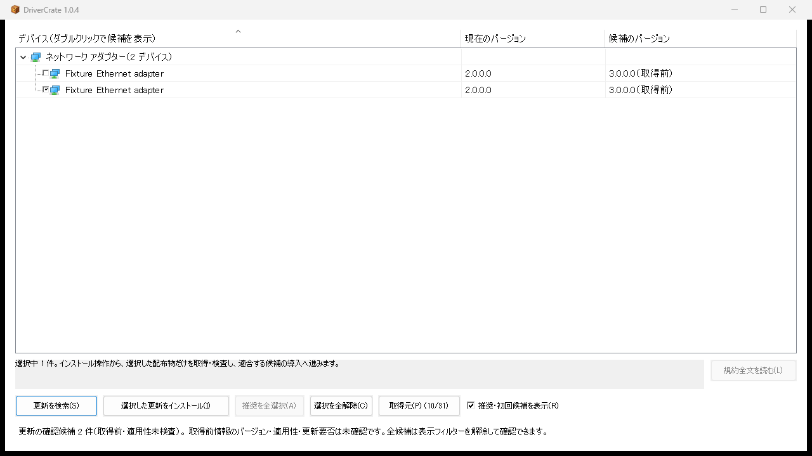
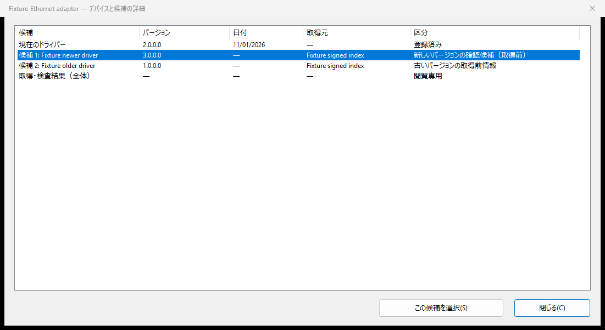

# DriverCrate

  

ドライバーの更新を、もっと手軽に。

DriverCrateは、Windows Updateやメーカーの公式配布元、PC内からドライバーの候補を探すWindowsアプリです。今のバージョンと見比べながら、必要なものだけ選んで更新できます。

## 📥 ダウンロード

**[最新バージョンをダウンロード（Windows x64）](https://github.com/EnterOgawa/drivercrate/releases/latest)**

配布ページの`DriverCrateSetup-windows-x64.exe`を開き、画面の案内に沿ってインストールしてください。必要なファイルはインストーラーがまとめて準備します。終わったら、スタートメニューからDriverCrateを開きましょう。

標準のインストール先は`%LOCALAPPDATA%\Programs\DriverCrate`です。起動時にWindowsの確認画面（UAC）が出たら、内容を確認して進めてください。

## ✨ できること

- Windows Update・メーカーの公式配布元・PC内のドライバーから候補を検索
- 現在のバージョンと見比べて、更新したいデバイスだけ選択
- 対応する候補の配布物を取得し、インストール前に内容と利用規約を確認
- インストールの結果や、再起動が必要かを確認

## 📊 収録しているドライバー情報

2026年11月25日（日本時間）に公開した第76世代の集計です。234の取得元から、内容を検査した488件のドライバー情報を収録しています。 [公開索引（第76世代）](https://github.com/EnterOgawa/drivercrate/releases/tag/index-v1-20261125-c58b0a1e9afd8a65dd6ccd4d71b086f5bc9708afdb36306ca655665de75104ea) · [現在の公開索引](https://github.com/EnterOgawa/drivercrate/blob/driver-index/index/current.json)

前回掲載した第65世代に含まれていなかった照合用デバイスIDを2件収録しています。いずれもメディアチェンジャーです。

Windowsのドライバークラスと配布情報をもとに、デバイスの種類ごとに集計しています。 [Windowsのデバイスクラス](https://learn.microsoft.com/ja-jp/windows-hardware/drivers/install/system-defined-device-setup-classes-available-to-vendors)

| デバイスの種類 | ドライバー情報 | 照合用デバイスID |
| --- | ---: | ---: |
| 内蔵オーディオ（HD Audio） | 209件 | 20,152件 |
| 内蔵スピーカー用アンプ | 1件 | 6件 |
| USBオーディオ | 4件 | 11件 |
| USB MIDI | 1件 | 1件 |
| 仮想オーディオ | 1件 | 1件 |
| グラフィックス（GPU） | 1件 | 212件 |
| USB画面出力アダプター | 2件 | 190件 |
| 仮想マシン用画面出力 | 2件 | 3件 |
| モニター | 124件 | 516件 |
| カメラ | 12件 | 209件 |
| RAIDコントローラー | 8件 | 353件 |
| SAS HBA | 7件 | 58件 |
| Fibre Channel HBA | 1件 | 8件 |
| NVMeコントローラー | 1件 | 7件 |
| SATA AHCIコントローラー | 1件 | 86件 |
| メディアチェンジャー | 1件 | 2件 |
| 仮想マシン用ストレージ | 5件 | 12件 |
| カードリーダー | 1件 | 2,853件 |
| ドライブ管理 | 1件 | 8件 |
| 有線LAN（PCI・PCIe） | 19件 | 1,458件 |
| 有線LAN（USB） | 4件 | 24件 |
| Wi-Fi | 2件 | 23件 |
| モバイル通信（WWAN） | 1件 | 3件 |
| 仮想マシン用ネットワーク | 2件 | 4件 |
| Bluetooth | 5件 | 11件 |
| USBバス関連 | 12件 | 162件 |
| USB機器 | 3件 | 11件 |
| HID入力機器 | 8件 | 1,538件 |
| キーボード | 1件 | 1件 |
| マウス | 1件 | 1件 |
| ポート（COM・LPT） | 13件 | 127件 |
| 多機能拡張カード | 1件 | 98件 |
| プリンター | 2件 | 16件 |
| スマートカードリーダー | 5件 | 141件 |
| 生体認証デバイス | 2件 | 3件 |
| セキュリティデバイス | 1件 | 7件 |
| システムデバイス | 23件 | 160件 |
| **合計** | **488件** | **28,476件** |

ドライバー情報は索引のレコード数です。照合用デバイスIDは、ハードウェアIDと互換IDの重複を除いた件数です。お使いのPCに合う候補は「更新を検索」でご確認ください。

## 🚀 使ってみよう

基本の操作は2ステップです。

### 1. 「更新を検索」を押す

画面下の「更新を検索」を押すと、デバイスごとに候補が並びます。「現在のバージョン」と「候補のバージョン」を見比べてみましょう。

### 2. 更新したい行にチェックを入れる

対象の行の左にチェックを入れ、「選択した更新をインストール」を押します。メーカー規約がある場合は、内容を確認して「同意してインストール」を押してください。

選んだドライバーをダウンロードし、署名やPCとの適合性を確認してからインストールします。終わったら、結果と再起動の案内を確認しましょう。

*画面は説明用のサンプルです。*

### 🔎 ほかの候補も見たいとき（任意）

「デバイス」の行をダブルクリックすると、「デバイスと候補の詳細」が開きます。表の「バージョン」「日付」「取得元」「区分」で候補を見比べられます。

使いたい行を選び、「この候補を選択」を押すと主画面に戻ります。そこで対象にチェックを入れて、インストールへ進みましょう。

詳細に「検査用に取得」が表示された候補は、ここで配布物の内容を確認できます。インストールする場合は、検査後に対象を選び、画面に表示される変更内容と利用規約を確認して進めてください。

古いバージョンも見たいときは、主画面の「推奨・初回候補を表示」のチェックを外してから詳細を開いてください。

## 🔄 アプリの更新

アプリは「ヘルプ」メニューから更新できます。新しいバージョンのお知らせが自動で届いたときも、その通知から更新できます。

## 📚 もっと詳しく

- [1.0.13の変更点](docs/release-notes-1.0.13.md)
- [詳しい使い方](docs/user-guide.md)
- [ビルドと試験](docs/testing.md)

## 📄 ライセンス

[Apache License 2.0](LICENSE)で公開しています。利用条件と、同梱しているライブラリの[第三者ライセンス](THIRD_PARTY_NOTICES.md)もご覧ください。
