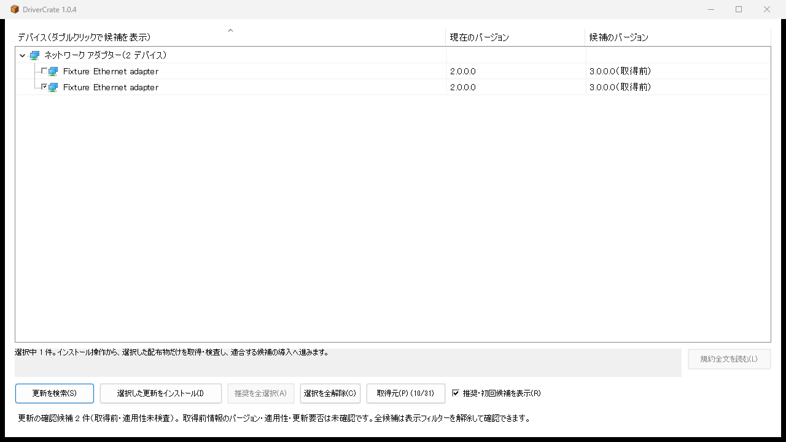
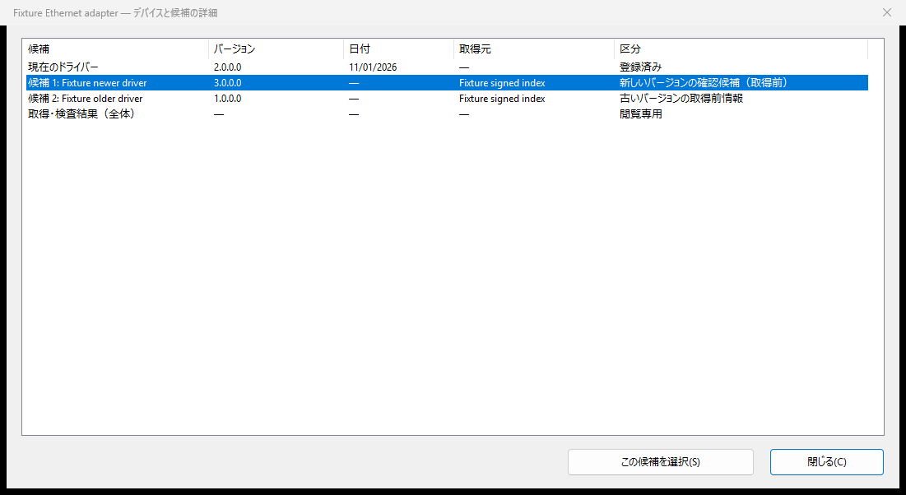

# DriverCrate

  

ドライバーの更新を、もっと手軽に。

DriverCrateは、Windows Updateやメーカーの公式配布元、PC内からドライバーの候補を探すWindowsアプリです。今のバージョンと見比べながら、必要なものだけ選んで更新できます。

## 📥 ダウンロード

**[最新バージョンをダウンロード（Windows x64）](https://github.com/EnterOgawa/drivercrate/releases/latest)**

配布ページの`DriverCrateSetup-windows-x64.exe`を開き、画面の案内に沿ってインストールしてください。必要なファイルはインストーラーがまとめて準備します。終わったら、スタートメニューからDriverCrateを開きましょう。

標準のインストール先は`%LOCALAPPDATA%\Programs\DriverCrate`です。起動時にWindowsの確認画面（UAC）が出たら、内容を確認して進めてください。

## ✨ できること

- Windows Update・メーカーの公式配布元・PC内のドライバーから候補を検索
- 現在のバージョンと見比べて、更新したいデバイスだけ選択
- インストールの結果や、再起動が必要かを確認

## 📊 収録しているドライバー情報

2026年11月11日に確認した[公開索引（世代32）](https://github.com/EnterOgawa/drivercrate/releases/tag/index-v1-20261111-9c1d39670cb67463733d86b70018419f1726ad01b27638b9519a6471c626f953)の収録数です。

| 項目 | 件数 |
| --- | ---: |
| ドライバー情報（索引レコード） | 442件 |
| デバイスID（重複除去） | 27,500件 |

実機で確認した台数や機種数ではありません。お使いのPCに合う候補は「更新を検索」で確認してください。

## 🚀 使ってみよう

基本の操作は2ステップです。

### 1. 「更新を検索」を押す

画面下の「更新を検索」を押すと、デバイスごとに候補が並びます。「現在のバージョン」と「候補のバージョン」を見比べてみましょう。

### 2. 更新したい行にチェックを入れる

対象の行の左にチェックを入れ、「選択した更新をインストール」を押します。メーカー規約がある場合は、内容を確認して「同意してインストール」を押してください。

選んだドライバーをダウンロードし、署名やPCとの適合性を確認してからインストールします。終わったら、結果と再起動の案内を確認しましょう。

*画面は説明用のサンプルです。*

### 🔎 ほかの候補も見たいとき（任意）

「デバイス」の行をダブルクリックすると、「デバイスと候補の詳細」が開きます。表の「バージョン」「日付」「取得元」「区分」で候補を見比べられます。

使いたい行を選び、「この候補を選択」を押すと主画面に戻ります。そこで対象にチェックを入れて、インストールへ進みましょう。

古いバージョンも見たいときは、主画面の「推奨・初回候補を表示」のチェックを外してから詳細を開いてください。

## 🔄 アプリの更新

アプリは「ヘルプ」メニューから更新できます。新しいバージョンのお知らせが自動で届いたときも、その通知から更新できます。

## 📚 もっと詳しく

- [詳しい使い方](docs/user-guide.md)
- [ビルドと試験](docs/testing.md)

## 📄 ライセンス

[Apache License 2.0](LICENSE)で公開しています。利用条件と、同梱しているライブラリの[第三者ライセンス](THIRD_PARTY_NOTICES.md)もご覧ください。
